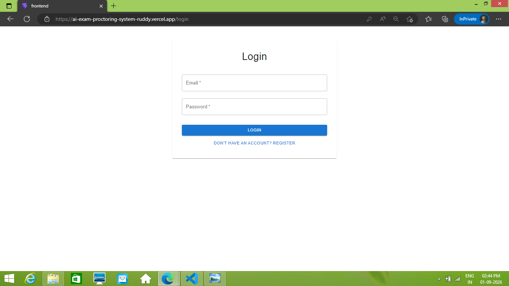
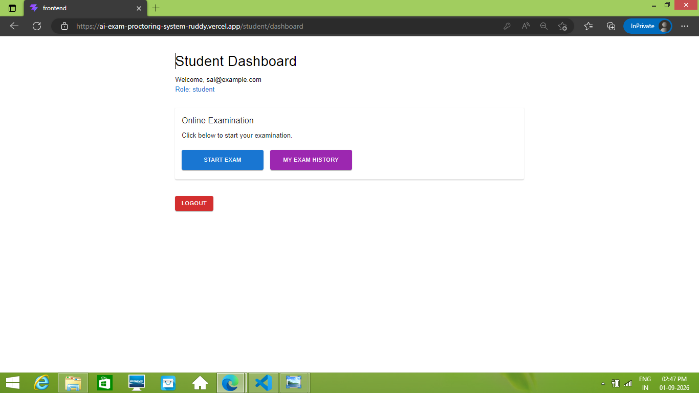
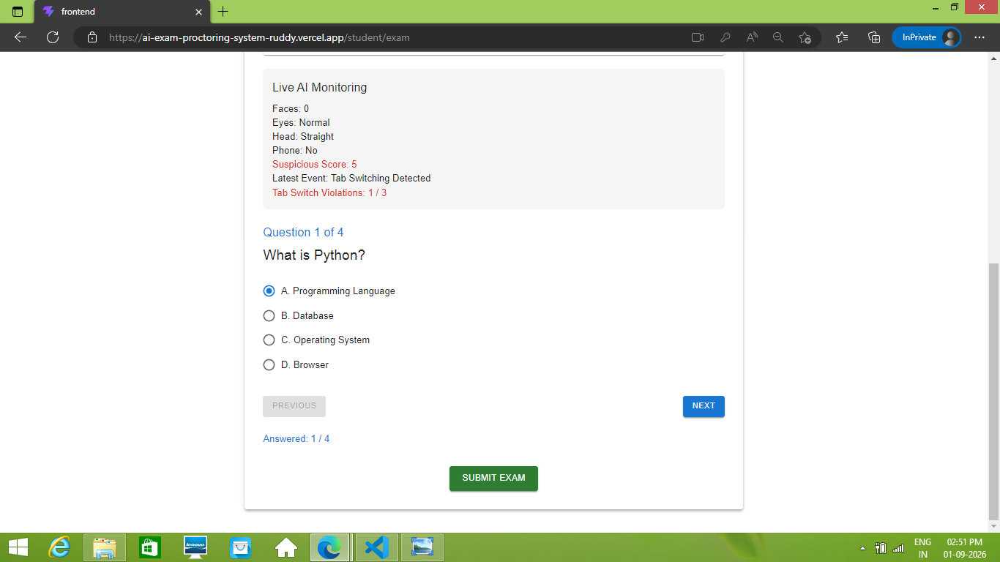
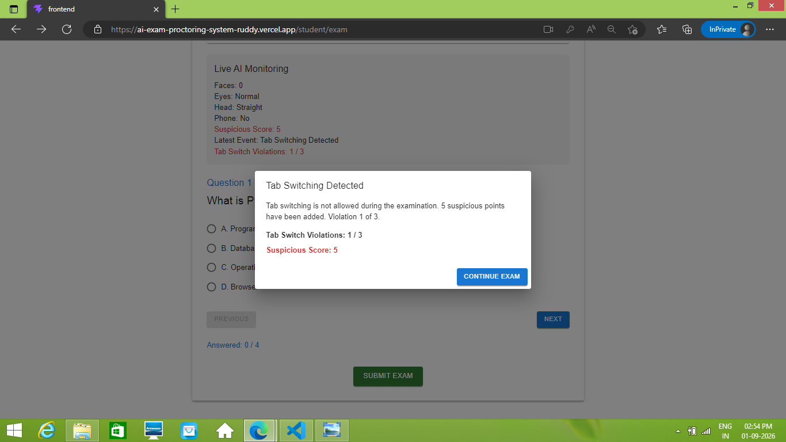
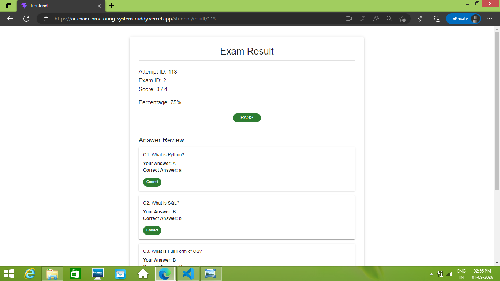
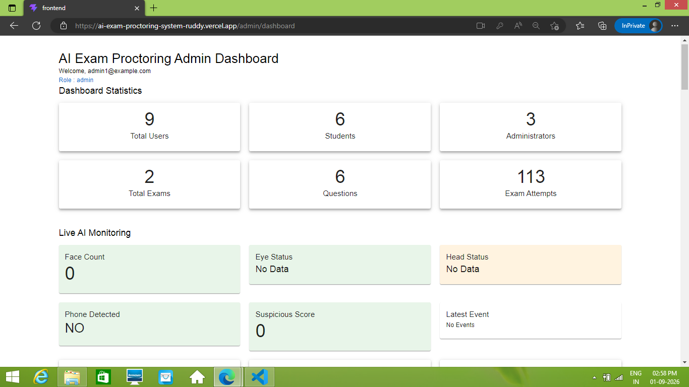
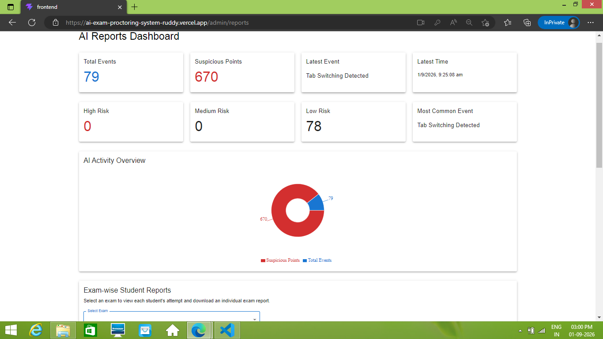
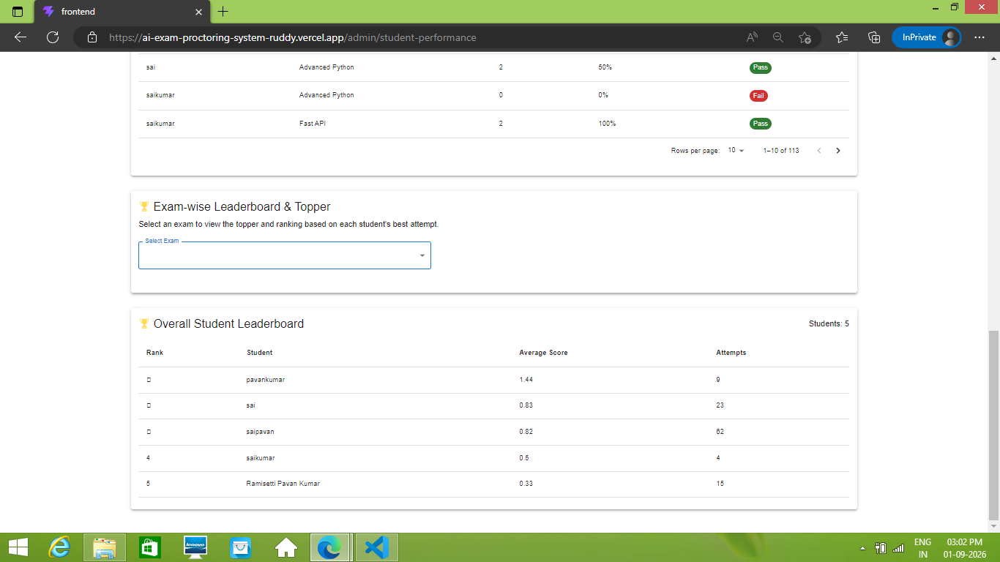
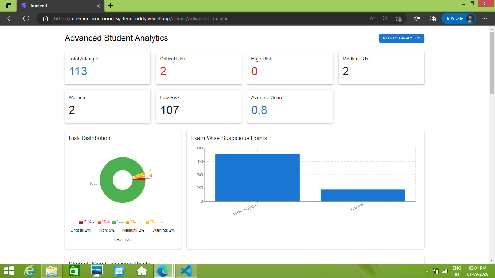
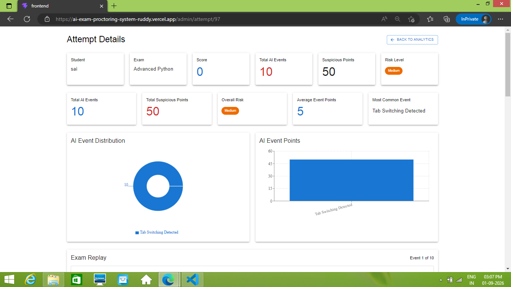

# AI Exam Proctoring System

An AI-powered online examination and proctoring platform built with **FastAPI, React, PostgreSQL, OpenCV, MediaPipe, and YOLOv8**.

The platform allows students to take online examinations while AI-based proctoring monitors suspicious behaviour such as multiple faces, looking away, abnormal head movement, tab switching, and other examination violations.

Administrators can manage users, exams, and questions, monitor student performance, review suspicious activities, generate exam-wise PDF reports, analyze individual attempts, and view exam-wise leaderboards and toppers.

---

## Live Demo

### Frontend

https://ai-exam-proctoring-system-ruddy.vercel.app

### Backend API

https://ai-exam-proctoring-backend.onrender.com

### Swagger API Documentation

https://ai-exam-proctoring-backend.onrender.com/docs

### Source Code

https://github.com/Boddusai/AI-Exam-Proctoring-System

---

## Deployment

The application is deployed using:

- **Frontend:** Vercel
- **Backend:** Render
- **Database:** Neon PostgreSQL
- **Source Code:** GitHub

The React frontend communicates with the FastAPI backend using environment-based API configuration.

Production WebSocket connections automatically use secure `wss://` communication when the backend is served over HTTPS.

---

# Key Features

## Student Features

- Student registration
- Student login
- JWT authentication
- Role-based authorization
- Student dashboard
- View available exams
- Select and start an exam
- Timed examinations
- Multiple-choice questions
- Previous and Next question navigation
- Automatic timer submission
- Manual exam submission
- Automatic submission after serious proctoring violations
- Exam results
- Correct / incorrect answer review
- Unanswered-question handling
- Exam history
- Browser camera monitoring
- Live AI proctoring
- Suspicious activity warnings
- Tab-switch detection

---

## Admin Features

- Admin dashboard
- User management
- Secure admin creation
- Exam management
- Question management
- AI reports dashboard
- Exam-wise student reports
- Individual student PDF reports
- Student performance analytics
- Exam-wise leaderboard
- Topper identification
- Overall leaderboard
- Advanced analytics
- Attempt details
- AI event replay
- AI activity timeline
- Risk analysis
- AI event history
- Search and filters
- CSV export
- PDF export

---

# AI Proctoring Features

The system currently supports:

- Face detection
- Multiple-face detection
- Eye monitoring
- Look-away detection
- Head pose detection
- Looking left detection
- Looking right detection
- Looking up detection
- Looking down detection
- Tab-switch detection
- Fullscreen-exit violation support
- Mobile phone detection support
- Suspicious activity scoring
- AI event persistence
- Attempt-based event tracking
- Warning popups
- Automatic exam termination
- Real-time WebSocket updates
- Browser camera frame analysis

---

# Suspicious Activity Point System

Each suspicious action contributes points to the current examination attempt.

| Activity | Points |
|---|---:|
| Looking Left | +2 |
| Looking Right | +2 |
| Looking Up | +2 |
| Looking Down | +2 |
| Looking Away | +2 |
| Multiple Faces Detected | +5 |
| Tab Switching | +5 |
| Fullscreen Exit | +5 |
| Mobile Phone Detected | +10 |

> Mobile phone detection is only active when YOLO phone detection is enabled on the backend.

---

# Warning and Auto-Termination Rules

The accumulated suspicious score determines the warning level.

| Suspicious Score | Action |
|---|---|
| 0–29 | Normal monitoring |
| 30 | First warning |
| 50 | Strong warning |
| 80 | Critical warning |
| 100 | Automatic exam termination and submission |

## Special Tab-Switch Rule

Tab switching has an additional independent termination rule.

```text
1st Tab Switch → +5 points
2nd Tab Switch → +5 points
3rd Tab Switch → +5 points + Immediate Exam Termination
```

Therefore, the exam is automatically terminated on the **third tab switch**, even if the overall suspicious score has not reached 100.

---

# Standardized Risk Levels

Risk levels are calculated using the total suspicious points associated with an examination attempt.

| Total Suspicious Points | Risk Level |
|---|---|
| 0–29 | Low |
| 30–49 | Warning |
| 50–79 | Medium |
| 80–99 | High |
| 100+ | Critical |

The same thresholds are used across:

- AI Reports
- Advanced Analytics
- Attempt Details
- Individual PDF reports

---

# Suspicious Score Reset

Every new examination attempt starts with a fresh AI monitoring state.

When a new attempt begins:

```text
Suspicious Score → 0
Tab Switch Count → 0
Latest Event → None
AI Event Flags → Reset
```

Previous AI events are **not deleted**.

They remain stored in PostgreSQL and continue to be available for:

- Attempt Details
- AI Reports
- PDF reports
- Advanced Analytics

---

# AI Proctoring Flow

```text
Student Camera
      ↓
React Frontend
      ↓
Browser Captures Compressed Camera Frame
      ↓
POST /proctor/analyze-frame
      ↓
FastAPI Backend
      ↓
OpenCV + MediaPipe
      ↓
Face / Eye / Head Analysis
      ↓
Suspicious Event Detection
      ↓
Suspicious Score Updated
      ↓
AI Event Stored in PostgreSQL
      ↓
WebSocket / API Status Update
      ↓
Admin Reports and Analytics
```

The student's webcam is accessed directly from the browser.

The frontend periodically captures frames and sends them to the backend for processing. This allows AI proctoring to work in cloud deployment without requiring the Render server to access the student's physical webcam.

---

# Browser Violation Monitoring

The frontend also detects browser-level examination violations.

## Tab Switching

The application monitors:

- Browser tab visibility changes
- Window focus loss

Duplicate browser events are suppressed to avoid recording the same switch twice.

Each recorded tab switch:

```text
+5 suspicious points
```

The third recorded tab switch terminates and automatically submits the exam.

---

# AI Detection Available in Production

The deployed Render version currently supports:

- Face detection
- Multiple-face detection
- Eye/look-away monitoring
- Head pose monitoring
- Looking left/right/up/down detection
- Suspicious score calculation
- AI event persistence
- Attempt association
- Browser violation logging
- Risk analysis
- Admin reporting

These features have been tested successfully in the deployed application.

---

# YOLO Phone Detection

YOLOv8-based mobile phone detection is included in the project.

The model is stored at:

```text
backend/yolov8n.pt
```

Phone detection can be enabled using:

```env
ENABLE_PHONE_DETECTION=true
```

For the current Render Free deployment:

```env
ENABLE_PHONE_DETECTION=false
```

YOLO phone detection is disabled in the current free deployment because loading **YOLO/PyTorch, MediaPipe, and OpenCV** together requires more memory than the free Render instance can reliably provide.

MediaPipe-based face, eye, and head monitoring remains enabled.

---

# Exam Result Calculation

Results are calculated using the complete number of questions in the selected exam.

Example:

```text
Total Questions: 2
Correct Answers: 1

Score: 1 / 2
Percentage: 50%
```

Unanswered questions are included in the review as:

```text
Your Answer: Not Answered
Result: Incorrect
```

This prevents incomplete attempts from incorrectly displaying results such as:

```text
1 / 1
100%
```

when the examination actually contains multiple questions.

---

# Exam-Wise Student PDF Reports

Administrators can select an exam and view all attempts associated with that exam.

Each attempt provides an individual downloadable PDF report.

The PDF contains:

## Student Details

- Student name
- Email
- Student ID
- Attempt ID

## Exam Details

- Exam title
- Subject
- Duration
- Score
- Total marks
- Attempt date

## Question Report

For every question:

- Question
- Option A
- Option B
- Option C
- Option D
- Student answer
- Correct answer
- Correct / Incorrect / Not Answered status

## AI Proctoring Summary

- Total AI events
- Total suspicious points
- Tab-switch count
- Risk level

## Suspicious Activity History

Each recorded event contains:

- Event name
- Points
- Timestamp

PDF generation is handled by the FastAPI backend using **ReportLab**.

---

# Exam-Wise Leaderboard

Administrators can select an exam and view rankings for that specific examination.

The leaderboard displays:

- Rank
- Student name
- Score
- Percentage
- Number of attempts
- Best attempt ID

The system uses each student's **best attempt** for the selected exam.

Example:

```text
Rank   Student        Score     Percentage
-------------------------------------------
🥇     Student A      9 / 10       90%
🥈     Student B      8 / 10       80%
🥉     Student C      7 / 10       70%
```

---

# Topper Identification

For every selected exam, the highest-ranked student is displayed separately as the topper.

Example:

```text
🏆 Topper

Student: Student A
Score: 9 / 10
Percentage: 90%
Best Attempt: #57
```

The system also prevents historical/inconsistent attempt values from displaying percentages above 100%.

---

# Student Performance Analytics

The Student Performance dashboard includes:

- Total students
- Total attempts
- Average score
- Highest score
- Average score by student
- Pass / fail analytics
- Student performance table
- Exam-wise leaderboard
- Topper
- Overall student leaderboard

---

# Advanced Analytics

The Advanced Analytics module provides:

- Total examination attempts
- Critical-risk attempts
- High-risk attempts
- Medium-risk attempts
- Warning-level attempts
- Low-risk attempts
- Average AI points
- Average AI events
- Average examination score
- Risk distribution
- Exam-wise suspicious points
- Student-wise suspicious points
- Suspicious activity trend
- Top suspicious students
- Search
- Risk filtering
- Date filtering
- Pagination
- CSV export
- PDF export

---

# Attempt Details

Administrators can open an individual attempt and view:

- Student information
- Exam information
- Exam score
- Total AI events
- Total suspicious points
- Overall risk
- Average event points
- Most common suspicious event
- Event-distribution chart
- Event-points chart
- Examination replay
- AI event timeline
- Complete AI event history

## Individual Event Weight

Individual AI events are displayed using event weight rather than overall attempt risk.

```text
2 points  → Minor
5 points  → Moderate
10 points → Major
```

Overall attempt risk is calculated separately using the standardized risk thresholds.

---

# Real-Time Monitoring

The application uses WebSockets for live AI monitoring.

Local development:

```text
ws://127.0.0.1:8000/ws/proctor
```

Production:

```text
wss://ai-exam-proctoring-backend.onrender.com/ws/proctor
```

WebSockets can provide live updates such as:

- Suspicious score
- Face count
- Eye status
- Head status
- Latest suspicious event

---

# Technology Stack

## Frontend

- React
- Vite
- Material UI
- Axios
- React Router
- Recharts
- jsPDF
- jsPDF AutoTable
- HTML5 MediaDevices API

## Backend

- Python 3.12
- FastAPI
- SQLAlchemy
- Pydantic
- JWT Authentication
- WebSockets
- Uvicorn
- ReportLab

## Database

- PostgreSQL
- Neon PostgreSQL

## AI / Computer Vision

- OpenCV
- MediaPipe
- YOLOv8
- Ultralytics
- TensorFlow Lite

## Deployment

- Vercel
- Render
- Neon
- GitHub

---

# Project Structure

```text
AI-Exam-Proctoring-System/
│
├── backend/
│   │
│   ├── app/
│   │   ├── ai/
│   │   │   ├── audio_detector.py
│   │   │   ├── current_attempt.py
│   │   │   ├── event_flags.py
│   │   │   ├── eye_tracker.py
│   │   │   ├── face_detector.py
│   │   │   ├── head_pose.py
│   │   │   ├── object_detector.py
│   │   │   ├── proctor_engine.py
│   │   │   ├── suspicious_score.py
│   │   │   ├── websocket_manager.py
│   │   │   └── ...
│   │   │
│   │   ├── auth/
│   │   ├── database/
│   │   ├── models/
│   │   ├── routers/
│   │   ├── schemas/
│   │   ├── services/
│   │   ├── utils/
│   │   └── main.py
│   │
│   ├── .env.example
│   ├── create_tables.py
│   ├── requirements.txt
│   └── yolov8n.pt
│
├── frontend/
│   │
│   ├── public/
│   ├── src/
│   │   ├── assets/
│   │   ├── components/
│   │   ├── pages/
│   │   │   ├── admin/
│   │   │   ├── auth/
│   │   │   └── student/
│   │   ├── routes/
│   │   ├── services/
│   │   └── utils/
│   │
│   ├── .env.example
│   ├── index.html
│   ├── package.json
│   ├── package-lock.json
│   ├── vite.config.js
│   └── vercel.json
│
├── .gitignore
└── README.md
```

---

# Database Structure

The project uses PostgreSQL hosted on Neon.

Major database entities include:

```text
Users
Exams
Questions
Exam Attempts
Student Answers
AI Events
```

## Main Relationships

```text
User
  ↓
ExamAttempt
  ↓
Exam

ExamAttempt
  ↓
StudentAnswer
  ↓
Question

ExamAttempt
  ↓
AIEvent
```

This allows all examination answers and AI events to remain connected to the correct examination attempt.

---

# Authentication and Authorization

The application uses JWT-based authentication with role-based authorization.

Supported roles:

```text
student
admin
```

## Student Registration

Public registration automatically creates a student account.

Users cannot assign themselves the administrator role through public registration.

## Admin Creation

An existing administrator can create another administrator through the secure User Management module.

---

# Student Workflow

```text
Register / Login
      ↓
Student Dashboard
      ↓
Select Exam
      ↓
Start New Attempt
      ↓
AI State Reset
      ↓
Camera Permission
      ↓
AI Monitoring Starts
      ↓
Answer Questions
      ↓
Warnings / Violation Monitoring
      ↓
Submit Exam
      ↓
Result
      ↓
Answer Review
      ↓
Exam History
```

---

# Admin Workflow

```text
Admin Login
      ↓
Admin Dashboard
      ↓
Manage Users
      ↓
Manage Exams
      ↓
Manage Questions
      ↓
AI Reports
      ↓
Exam-wise PDF Reports
      ↓
Student Performance
      ↓
Exam-wise Leaderboard / Topper
      ↓
Advanced Analytics
      ↓
Attempt Details
      ↓
AI Event Timeline / Replay
```

---

# Installation

## 1. Clone the Repository

```bash
git clone https://github.com/Boddusai/AI-Exam-Proctoring-System.git
```

Move into the project:

```bash
cd AI-Exam-Proctoring-System
```

---

# Backend Setup

Move into the backend directory:

```bash
cd backend
```

Python 3.12 is recommended for compatibility with the AI dependencies used by this project.

Create a virtual environment:

```bash
python -m venv venv312
```

Activate it on Windows:

```bash
venv312\Scripts\activate
```

Install dependencies:

```bash
pip install -r requirements.txt
```

Create:

```text
backend/.env
```

using:

```text
backend/.env.example
```

Example:

```env
DATABASE_URL=your_postgresql_database_url
SECRET_KEY=your_secret_key
ALGORITHM=HS256
ACCESS_TOKEN_EXPIRE_MINUTES=30
CORS_ORIGINS=http://localhost:5173
ENABLE_PHONE_DETECTION=false
```

Start the backend:

```bash
uvicorn app.main:app --reload
```

Backend:

```text
http://127.0.0.1:8000
```

Swagger:

```text
http://127.0.0.1:8000/docs
```

---

# Frontend Setup

Open another terminal:

```bash
cd frontend
```

Install dependencies:

```bash
npm install
```

Create:

```text
frontend/.env
```

Example:

```env
VITE_API_URL=http://127.0.0.1:8000
```

Start the frontend:

```bash
npm run dev
```

Frontend:

```text
http://localhost:5173
```

Production build:

```bash
npm run build
```

---

# Environment Variables

## Backend

```env
DATABASE_URL=your_postgresql_database_url
SECRET_KEY=your_secret_key
ALGORITHM=HS256
ACCESS_TOKEN_EXPIRE_MINUTES=30
CORS_ORIGINS=http://localhost:5173
ENABLE_PHONE_DETECTION=false
```

## Frontend

```env
VITE_API_URL=http://127.0.0.1:8000
```

In production, `VITE_API_URL` points to the Render backend.

---

# Security

Sensitive files are excluded using `.gitignore`.

Examples:

```text
backend/.env
frontend/.env

backend/venv/
backend/venv312/

frontend/node_modules/
frontend/dist/
frontend/.vercel/

__pycache__/
*.pyc
```

Only safe example configuration files should be committed:

```text
backend/.env.example
frontend/.env.example
```

Database credentials and JWT secrets must never be committed to GitHub.

---

# Render Free Tier Optimization

The backend currently runs on a limited-memory Render deployment.

Several optimizations are used:

- Browser frames are compressed before upload
- AI processing occurs periodically instead of at full video frame rate
- Heavy computer-vision modules are lazy-loaded
- YOLO phone detection is disabled by default
- MediaPipe face, eye, and head detection remains enabled
- The cloud server analyzes browser-uploaded frames rather than accessing a webcam directly

---

# Production Verification

The production application has been tested successfully for:

## Authentication

- Student registration
- Student login
- Admin login
- JWT authentication
- Role-based routing
- Secure administrator creation

## Administration

- User management
- Exam management
- Question management

## Student Examination

- Exam selection
- Exam attempt creation
- Timer
- Question navigation
- Answer submission
- Unanswered questions
- Correct score calculation
- Result review
- Exam history

## AI Proctoring

- Browser camera access
- Camera frame upload
- Face detection
- Multiple-face detection
- Eye/look-away detection
- Head pose detection
- Suspicious score calculation
- Tab-switch detection
- Three-tab auto termination
- Warning thresholds
- Automatic submission
- Score reset for new attempts
- AI event persistence
- Correct attempt/event association

## Administration Analytics

- AI Reports
- Exam-wise reports
- Individual PDF downloads
- Student Performance
- Exam-wise leaderboard
- Topper
- Advanced Analytics
- Attempt Details
- Risk-level consistency
- CSV export
- PDF export

## Deployment

- Neon PostgreSQL
- Render backend
- Vercel frontend
- GitHub repository

---

# System Architecture

The AI Exam Proctoring System follows a client-server architecture with separate frontend, backend, database, and AI-processing layers.

                    ┌──────────────────────┐
                    │      Student         │
                    │   React Frontend     │
                    └──────────┬───────────┘
                               │
                               │ HTTPS / REST API
                               │
                    ┌──────────▼───────────┐
                    │   FastAPI Backend    │
                    │ Authentication       │
                    │ Exam Management      │
                    │ Proctoring APIs      │
                    │ Reports / Rankings   │
                    └───────┬───────┬──────┘
                            │       │
                            │       │
                  ┌─────────▼───┐   │
                  │ PostgreSQL  │   │
                  │ Neon DB     │   │
                  └─────────────┘   │
                                    │
                         ┌──────────▼──────────┐
                         │ AI Proctoring Layer │
                         │ OpenCV              │
                         │ MediaPipe           │
                         │ YOLOv8              │
                         └──────────┬──────────┘
                                    │
                                    │ AI Events
                                    │ Suspicious Score
                                    ▼
                         ┌─────────────────────┐
                         │ Admin Analytics     │
                         │ AI Reports          │
                         │ Attempt Details     │
                         │ Leaderboard         │
                         │ PDF Reports         │
                         └─────────────────────┘

# Screenshots

## Student Login



---

## Student Dashboard



---

## Online Examination with AI Proctoring



---

## Suspicious Activity Warning



---

## Examination Result



---

## Admin Dashboard



---

## Exam-Wise Student Reports



---

## Exam-Wise Leaderboard and Topper



---

## Advanced Analytics



---

## Individual Attempt Details



# Current Project Status

The core **AI Exam Proctoring System is complete, deployed, and production-tested**.

### Frontend

https://ai-exam-proctoring-system-ruddy.vercel.app

### Backend

https://ai-exam-proctoring-backend.onrender.com

### Swagger

https://ai-exam-proctoring-backend.onrender.com/docs

### GitHub

https://github.com/Boddusai/AI-Exam-Proctoring-System

---

# Known Deployment Limitation

YOLO-based phone detection is currently disabled on the Render Free deployment because of memory limitations.

All core MediaPipe-based proctoring features remain available in production.

Phone detection can be enabled when the backend is deployed on an environment with additional memory.

---

# Future Improvements

Potential future enhancements include:

- Higher-memory deployment for YOLO phone detection
- Face identity verification
- Student identity matching before examination
- Screen recording
- Voice activity detection
- Advanced cheating-prediction models
- Evidence image/video storage
- Email notifications
- More advanced administrator analytics
- Multi-user proctoring architecture improvements
- Automated backend tests
- Automated frontend tests
- CI/CD improvements
- Frontend code splitting
- Performance optimization
- Improved production scalability

---

# Author

**Boddu Sai Pavan**

GitHub:

https://github.com/Boddusai

---

# License

This project was developed for **educational, learning, internship, demonstration, and portfolio purposes**.