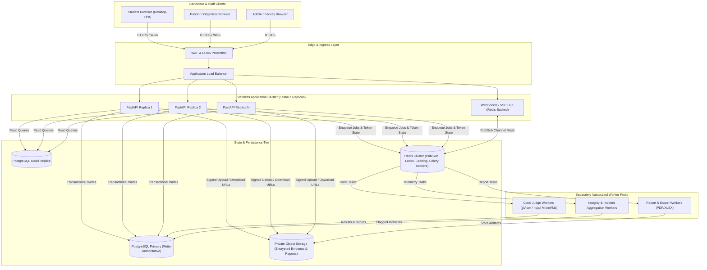
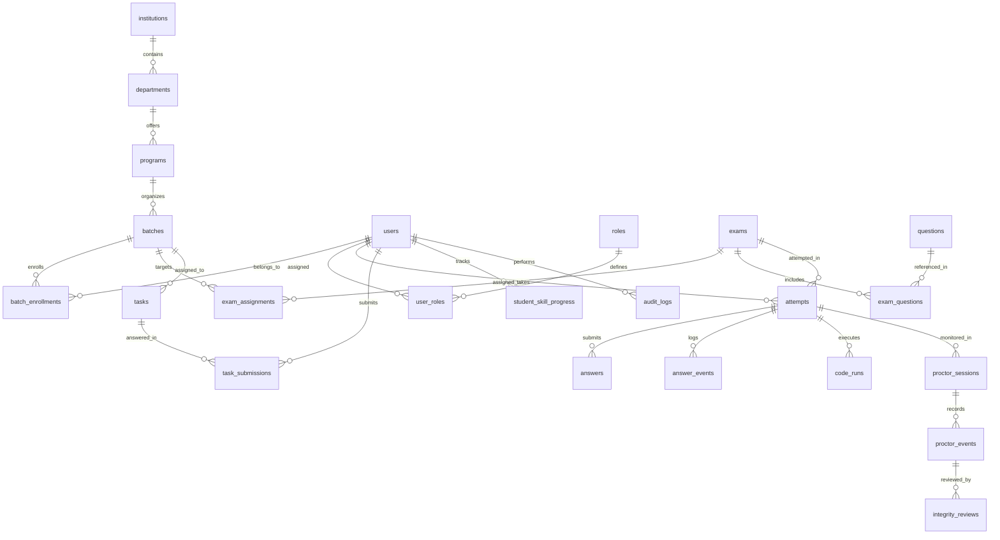
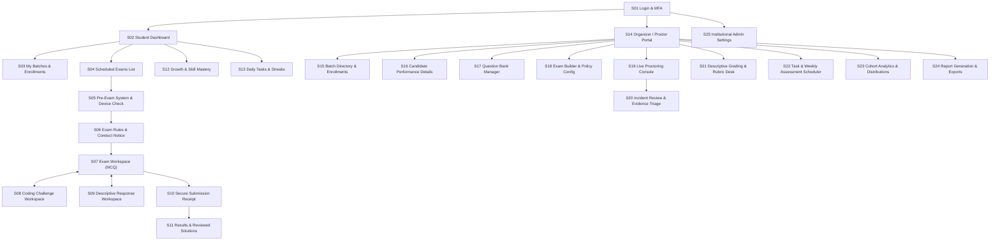
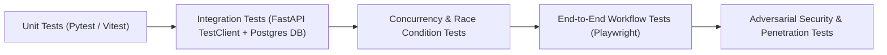
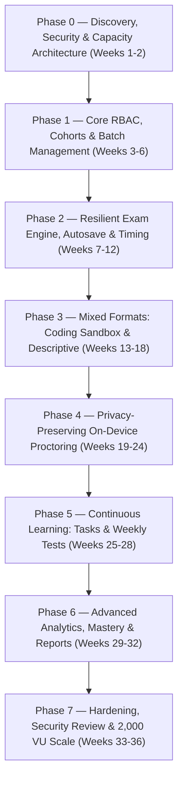

# TestNest — System Architecture, UI Specification & Delivery Plan

**Version:** 1.0  
**Target:** Single Institution Examination & Continuous Learning Platform  
**Target Concurrency:** 500 – 2,000 Active Candidates  
**Date:** 22 November 2026  

---

## 1. System Architecture & Topology Proposal

To meet the 2,000 concurrent candidate scale requirement while guaranteeing zero answer loss and sub-500 ms p95 save latency, TestNest adopts a **Modular Monolith for Core Business Services** combined with **Separately Scalable Background Workers** for asynchronous code judging, report generation, and AI telemetry aggregation.

### 1.1 High-Level Architecture Diagram



### 1.2 Key Architectural Tenets
1. **Edge Client-Side Inference Over Server Video Streaming:**
   - Raw video feeds from 2,000 webcams will **never** be streamed continuously to central servers.
   - Inference (face presence, multiple faces, head direction) is executed on the client browser using MediaPipe JavaScript / WebAssembly.
   - Only policy-defined violation triggers (e.g., absence $>5$ s, multiple faces $>3$ s, focus loss) dispatch signed lightweight JSON payloads ($\le 1\text{ KB}$) to the backend.
   - Visual snapshots (downscaled to $320\times 240$ JPEG, $\approx 15\text{ KB}$) are captured **only upon confirmed event thresholds**, pre-signed, and uploaded directly to private S3 storage.
2. **PostgreSQL as Sole Authoritative Source of Truth:**
   - Every acknowledged answer revision is committed transactionally to PostgreSQL.
   - Redis is used strictly for transient caching, distributed locks, session state, rate limiting, and message queue brokering.
3. **Decoupled Asynchronous Coding Sandbox:**
   - Untrusted student code is isolated from API workers.
   - Submissions are queued via Redis and executed inside isolated ephemeral sandbox environments (gVisor runsc / nsjail containers) with strict CPU (1 core), memory (256 MB), timeout (5 s), read-only root filesystems, and zero egress networking.
4. **Resilient Idempotent Autosave:**
   - Answers are saved continuously using monotonically increasing revision numbers and client-generated UUID idempotency keys.
   - Saves are debounced on key-up (1,000 ms) and triggered instantly on question change or window blur.

---

## 2. Existing vs. Required Feature Matrix

| Functional Area | TestNest Requirement | Current Implementation | Gap Severity | Architectural Remediation |
| :--- | :--- | :--- | :--- | :--- |
| **RBAC & Auth** | Student, Faculty, Organizer, Admin; MFA for staff; institutional login | Flat `admin` / `student` roles; registration allows self-escalation | **CRITICAL** | Introduce `roles`, `permissions`, and `user_roles`. Remove open role selection. Add staff MFA and institutional domain restriction. |
| **Cohorts** | Departments, programs, academic years, sections, batches; bulk CSV import | None (flat users table) | **CRITICAL** | Build institutional hierarchy tables (`departments`, `programs`, `batches`, `batch_enrollments`). Add CSV validator service. |
| **Question Bank** | Versioned bank; MCQ, coding, descriptive; difficulty, outcomes, rubrics | Flat 4-option MCQ table without versioning or metadata | **HIGH** | Replace `questions` table with polymorphic question schema (`content_json`, `rubric_json`, `test_cases`). Version questions immutably. |
| **Exam Engine** | Draft $\to$ Scheduled $\to$ Open $\to$ Closed $\to$ Published lifecycle; immutable snapshot | Draft creation only; no state machine; mutable live questions | **HIGH** | Implement `Exam` lifecycle state machine. Snapshot `exam_questions` with point allocations and versions upon publishing. |
| **Scheduling & Timers** | Server-authoritative start/expiry; late entry; accommodations | Client React countdown; no start/expiration timestamps in DB | **CRITICAL** | Store `started_at` and `expires_at` in `exam_attempts`. Enforce server-side rejection on expired writes. Support per-student extra time. |
| **Autosave** | Idempotent incremental saves; p95 $< 500$ ms; zero answer loss | Answers stored only in React state; bulk submit only | **CRITICAL** | Create `answers` and `answer_events` tables. Implement `PUT /attempts/{id}/answers/{question_id}` with idempotency keys and sequence tracking. |
| **Coding Sandbox** | Monaco editor; multi-language; hidden tests; isolated sandbox | None | **HIGH** | Embed `@monaco-editor/react`. Implement queue-backed judge worker using gVisor/Docker runner with isolated grading pipeline. |
| **Descriptive Grading** | Text answers, file uploads, rubrics, manual markers, blind grading | None | **HIGH** | Add rich-text/plain descriptive answer support; S3 upload for attachments; faculty grading interface with rubric scoring. |
| **Proctoring Engine** | Consented client-side inference; tab switch, fullscreen; event queue | Server-side image decoding and MediaPipe/YOLO per request | **CRITICAL** | Migrate face/pose detection to browser MediaPipe Wasm. Server ingests structured events (`POST /attempts/{id}/proctor-events`). |
| **Incident Review** | Human-in-the-loop triage; evidence viewer; dismissal/escalation | Automated termination at 100 pts or 3 tab switches | **CRITICAL** | Remove automatic failure. Direct events into `integrity_reviews` table. Provide organizer evidence review UI. |
| **Daily Tasks** | Daily assignments; recurring templates; streaks; progress | None | **MEDIUM** | Implement `tasks`, `task_assignments`, and `task_submissions` tables with recurring scheduler engine. |
| **Analytics & Reports** | Outcome mastery; cohort stats; background PDF/Excel exports | Basic Recharts; bugged PDF script aggregating all students | **HIGH** | Add `reports` table; offload ReportLab PDF and OpenPyXL Excel generation to background Celery workers; fix query scoping. |
| **Audit & Governance** | Append-only audit logs; 30-day evidence retention; DPDP compliance | No audit logs; no retention deletion jobs | **HIGH** | Implement `audit_logs` table. Add automated retention lifecycle jobs to prune evidence thumbnails after 30 days. |

---

## 3. Database Migration Plan & Logical Schema

To transition from the initial prototype to the robust TestNest schema without data corruption, we establish an **Alembic migration pipeline** with explicit backward compatibility and step-by-step schema promotions.

### 3.1 Logical Entity Relationship (Target Schema)



### 3.2 Target Relational Table Definitions

1. **`users`:** `id` (UUID PK), `institution_id` (FK), `email` (VARCHAR 255, UNIQUE), `password_hash` (VARCHAR 255), `full_name` (VARCHAR 255), `student_id` (VARCHAR 64, UNIQUE NULLABLE), `is_active` (BOOL), `mfa_secret` (VARCHAR NULLABLE), `created_at` (TIMESTAMPTZ), `updated_at` (TIMESTAMPTZ).
2. **`roles` & `user_roles`:** `id` (INT PK), `name` (VARCHAR 50, UNIQUE: `admin`, `organizer`, `faculty`, `student`); `user_roles`: `user_id` (FK), `role_id` (FK), `scope_type` (VARCHAR), `scope_id` (UUID NULLABLE), `assigned_at` (TIMESTAMPTZ).
3. **`departments`, `programs`, `batches`:**
   - `departments`: `id` (UUID PK), `code` (VARCHAR 20, UNIQUE), `name` (VARCHAR 255), `created_at`.
   - `programs`: `id` (UUID PK), `department_id` (FK), `name` (VARCHAR 255), `degree_level` (VARCHAR 50).
   - `batches`: `id` (UUID PK), `program_id` (FK), `academic_year` (VARCHAR 20), `section` (VARCHAR 20), `label` (VARCHAR 100), `is_active` (BOOL).
4. **`batch_enrollments`:** `id` (UUID PK), `batch_id` (FK), `student_id` (FK), `joined_at` (TIMESTAMPTZ), `status` (VARCHAR 20: `active`, `withdrawn`, `graduated`), UNIQUE (`batch_id`, `student_id`).
5. **`questions`:** `id` (UUID PK), `institution_id` (FK), `type` (VARCHAR 20: `mcq_single`, `mcq_multi`, `coding`, `descriptive`), `topic` (VARCHAR 100), `difficulty` (VARCHAR 20: `easy`, `medium`, `hard`), `version` (INT DEFAULT 1), `content_json` (JSONB: prompt, code boilerplate, options, hidden), `solution_key_json` (JSONB: restricted, never sent during exam), `marks` (NUMERIC(5,2)), `created_by` (FK), `created_at` (TIMESTAMPTZ).
6. **`exams`:** `id` (UUID PK), `institution_id` (FK), `title` (VARCHAR 255), `subject` (VARCHAR 255), `status` (VARCHAR 30: `draft`, `scheduled`, `open`, `closed`, `grading`, `published`), `opens_at` (TIMESTAMPTZ), `closes_at` (TIMESTAMPTZ), `duration_sec` (INT), `policy_json` (JSONB: negative marking, shuffle, late entry grace, accommodations), `published_version` (INT DEFAULT 1), `created_by` (FK), `created_at` (TIMESTAMPTZ).
7. **`exam_questions`:** `id` (UUID PK), `exam_id` (FK), `question_id` (FK), `question_version` (INT), `ordering` (INT), `points` (NUMERIC(5,2)), UNIQUE (`exam_id`, `question_id`).
8. **`exam_assignments`:** `id` (UUID PK), `exam_id` (FK), `batch_id` (FK), `assigned_at` (TIMESTAMPTZ), UNIQUE (`exam_id`, `batch_id`).
9. **`attempts`:** `id` (UUID PK), `exam_id` (FK), `student_id` (FK), `started_at` (TIMESTAMPTZ), `expires_at` (TIMESTAMPTZ), `state` (VARCHAR 30: `in_progress`, `submitted`, `expired`, `disqualified`), `submitted_at` (TIMESTAMPTZ NULLABLE), `score` (NUMERIC(6,2) NULLABLE), `client_metadata_json` (JSONB: browser, IP, OS), UNIQUE (`exam_id`, `student_id`).
10. **`answers`:** `id` (UUID PK), `attempt_id` (FK), `question_id` (FK), `revision` (INT DEFAULT 1), `payload_json` (JSONB: chosen options, code text, descriptive body, attachments), `is_final` (BOOL DEFAULT TRUE), `saved_at` (TIMESTAMPTZ), UNIQUE (`attempt_id`, `question_id`).
11. **`answer_events`:** `id` (BIGSERIAL PK), `attempt_id` (FK), `question_id` (FK), `client_sequence` (INT), `idempotency_key` (UUID UNIQUE), `payload_json` (JSONB), `received_at` (TIMESTAMPTZ).
12. **`code_runs`:** `id` (UUID PK), `attempt_id` (FK), `question_id` (FK), `language` (VARCHAR 30), `status` (VARCHAR 30: `queued`, `running`, `passed`, `failed`, `timeout`, `error`), `test_results_json` (JSONB: public test cases), `sandbox_ref` (VARCHAR 100), `execution_time_ms` (INT), `created_at` (TIMESTAMPTZ).
13. **`proctor_sessions` & `proctor_events`:**
    - `proctor_sessions`: `id` (UUID PK), `attempt_id` (FK UNIQUE), `permission_state` (JSONB: camera, screen, mic), `started_at` (TIMESTAMPTZ), `ended_at` (TIMESTAMPTZ NULLABLE).
    - `proctor_events`: `id` (UUID PK), `session_id` (FK), `event_type` (VARCHAR 50: `face_absent`, `multiple_faces`, `tab_switch`, `fullscreen_exit`, `phone_detected`), `severity` (VARCHAR 20: `low`, `medium`, `high`, `critical`), `occurred_at` (TIMESTAMPTZ), `evidence_ref` (VARCHAR 255 NULLABLE: private S3 object key), `metadata_json` (JSONB).
14. **`integrity_reviews`:** `id` (UUID PK), `event_id` (FK), `reviewer_id` (FK), `decision` (VARCHAR 30: `dismissed`, `needs_action`, `confirmed_violation`), `rationale` (TEXT), `reviewed_at` (TIMESTAMPTZ).
15. **`tasks`, `task_submissions`, `student_skill_progress`:** Continuous learning, recurring assignments, and outcome mastery progression.
16. **`reports` & `audit_logs`:** Background report metadata with signed storage keys; append-only tamper-proof administrative and academic audit events.

### 3.3 Migration Phasing & Data Backfill Strategy
- **Step 1: Alembic Baseline Initialization:** Initialize Alembic (`alembic init alembic`) with environment configurations reading from `DATABASE_URL`.
- **Step 2: Table Partitioning & Composite Indexes:**
  - Create index on `attempts(exam_id, student_id)`.
  - Create index on `answers(attempt_id, question_id)`.
  - Create index on `proctor_events(session_id, occurred_at)`.
  - Create index on `answer_events(idempotency_key)`.
- **Step 3: Zero-Downtime Data Backfill:**
  - Map legacy `users` table to new schema, assigning `student` role by default, while converting existing admins to role `admin`.
  - Backfill existing `exams` into target schema setting `status = 'published'` and `opens_at = created_at`.
  - Upgrade legacy `exam_attempts` by synthesizing `started_at = submitted_at - INTERVAL '30 minutes'` and `state = 'submitted'`.
  - Drop deprecated singleton table `ai_status`.

---

## 4. API Specification (Illustrative Contract)

### 4.1 Authentication & Cohorts
- `POST /api/v1/auth/login`: Authenticate candidate or faculty; issue scoped access and refresh tokens.
- `GET /api/v1/me`: Retrieve authenticated profile, assigned roles, permissions, and active batch enrollments.
- `POST /api/v1/batches/{id}/enrollments/bulk`: Administrator bulk CSV enrollment with student ID validation and duplicate detection.

### 4.2 Examination & Autosave Engine
- `POST /api/v1/exams/{id}/attempts`: Transactional attempt initialization. Performs eligibility checks, validates `opens_at <= NOW() <= closes_at`, calculates `expires_at = MIN(NOW() + duration_sec, closes_at)`, initializes `proctor_session`, and returns attempt token.
- `PUT /api/v1/attempts/{id}/answers/{question_id}`:
  ```json
  // Request Payload
  {
    "client_sequence": 14,
    "idempotency_key": "9c1a5b82-7d23-42e1-b489-08d4b38d3810",
    "payload": {
      "type": "mcq_single",
      "selected_option_id": "opt_b"
    }
  }
  // Response (200 OK)
  {
    "status": "acknowledged",
    "revision": 3,
    "server_time": "2026-11-22T02:08:00.125Z",
    "expires_at": "2026-11-22T03:00:00.000Z"
  }
  ```
- `POST /api/v1/attempts/{id}/code-runs`: Submits candidate code to the async judge queue; returns execution ticket for polling/WebSocket streaming.
- `POST /api/v1/attempts/{id}/submit`: Idempotent attempt finalization. Locks attempt record, flushes pending in-flight writes, verifies expiration grace window, computes deterministic auto-scored sections, and marks state `submitted`.

### 4.3 Proctoring & Integrity Telemetry
- `POST /api/v1/attempts/{id}/proctor-events`:
  ```json
  // Bounded Telemetry Payload
  {
    "event_type": "face_absent",
    "severity": "medium",
    "duration_ms": 6200,
    "occurred_at": "2026-11-22T02:15:30.000Z",
    "has_evidence": true
  }
  // Response (201 Created)
  {
    "event_id": "evt_48f93a20",
    "upload_evidence_url": "https://s3.institution.edu/evidence/evt_48f93a20.jpg?signed=..."
  }
  ```
- `GET /api/v1/exams/{id}/monitor`: Server-Sent Events (SSE) or WebSocket feed for proctors providing prioritized aggregate queues, candidate status, and filterable alerts.
- `POST /api/v1/integrity-reviews`: Human proctor review outcome: `event_id`, `decision` (`dismissed`, `needs_action`, `confirmed`), and `rationale`.

---

## 5. Screen-by-Screen UI Specification (S01 – S25)

The interface adheres to an institutional design standard: **professional light mode with deep navy (`#0B2545`) and calm teal (`#134074`, `#007F5F`) accents**, clean typography (Inter / Roboto), and zero distracting non-essential visual elements inside the exam workspace.



### Detailed Screen Breakdown

- **S01 Institutional Login:** Single-sign-on or student email authentication, MFA verification for faculty/admins, institutional privacy and data-protection notice.
- **S02 Student Home:** Dashboard showing upcoming scheduled exams, daily task streaks, active batch notices, and recent published scores.
- **S03 My Batches:** Enrolled academic programs, sections, assigned faculty coordinators, and batch announcements.
- **S04 Exam List:** Segmented tabs for `Upcoming`, `Active / Open Now`, and `Completed / Past Exams`. Displays duration, eligibility status, and scheduled start/close windows.
- **S05 Device & Readiness Check:** Camera permission check, audio input validation, browser compatibility verification, network speed test, and explicit proctoring consent confirmation.
- **S06 Exam Instructions & Accommodations:** Mandatory review of exam rules, point schemes, negative marking details, time limits, accommodation extensions (if approved), and code of conduct.
- **S07 Unified Exam Workspace (MCQ):**
  - **Header:** Sticky countdown timer synchronized with server `expires_at`, real-time autosave status pill (`Saved` / `Saving...` / `Offline — Retrying`), and prominent manual `Submit Exam` button with confirmation modal.
  - **Left / Center Pane:** Clear question prompt, code snippets (with syntax highlighting), option cards with radio/checkbox selectors and keyboard accessibility (keys `1-4` / `A-D`).
  - **Right Pane:** Question navigation palette (answered, flagged for review, unvisited), compact webcam self-preview thumbnail with clear non-obstructive status indicator (`Monitoring Active`).
- **S08 Coding Workspace:** Embedded Monaco Editor with language picker (Python, Java, C++, JavaScript), code reset, sample input/output runner, execution console, test case results table, and resource limit warnings.
- **S09 Descriptive Workspace:** Distraction-free text editor with live word count, optional file attachment dropzone (restricted to PDF/PNG $\le 5$ MB), and auto-draft persistence.
- **S10 Submission Receipt:** Immutable submission proof displaying Attempt UUID, server timestamp, total questions answered, and digital signature hash.
- **S11 Results & Detailed Explanations:** Score summary, section-wise breakdown, teacher feedback, and solution explanations (displayed only after exam results are published).
- **S12 Student Growth Profile:** Outcome mastery radar charts, longitudinal performance trendlines across weeks, and topic strength/weakness diagnostics.
- **S13 Daily Tasks:** Recurring task queue, due dates, submission portal, and streak calendar.
- **S14 Organizer / Proctor Overview:** High-level dashboard displaying active ongoing exams, active candidate counts, alert volume, and batch statistics.
- **S15 Batch Directory & Enrollment Manager:** Batch roster tables, filtering by department/year, student profile drill-down, and CSV bulk importer with error validation.
- **S16 Student Academic Detail:** Individual student history, attendance records, exam attempts, incident logs, and faculty intervention notes.
- **S17 Question Bank Manager:** Repository for creating, editing, and versioning questions. Tagging by topic, Bloom's taxonomy level, difficulty, and automated test cases.
- **S18 Exam Builder & Policy Studio:** Section configuration, question selection from bank, duration settings, scheduling windows, shuffle policies, negative marking toggles, and draft preview.
- **S19 Live Proctoring Console:** Grid of active candidates with connection status pills, aggregate suspicious severity indicators, filterable candidate search, and a real-time prioritized incident alert stream.
- **S20 Incident Review & Evidence Triage:** Contextual evidence viewer displaying violation timestamp, incident classification, snapshot image, candidate screen activity timeline, reviewer disposition buttons (`Dismiss`, `Escalate`, `Confirm Violation`), and rationale field.
- **S21 Descriptive Grading Desk:** Split-screen grading view: student answer text/attachment on the left, rubric scoring sliders and moderator override controls on the right.
- **S22 Task & Weekly Test Scheduler:** Recurring assignment creator with batch assignment, release/deadline rules, and pool-based weekly test generation.
- **S23 Advanced Cohort Analytics:** Batch comparison histograms, score distribution curves, question discrimination index, and outlier detection.
- **S24 Institutional Reports & Exports:** Filterable report builder for batch grade sheets, proctoring summary audits, and student performance summaries in PDF and XLSX formats.
- **S25 Institutional Administration:** Role permissions management, retention schedule configuration, audit log viewer, and integration settings.

---

## 6. Security, Privacy & Compliance Threat Model

### 6.1 STRIDE Threat Analysis

| Threat Category | Potential Attack Vector | TestNest Architectural Countermeasure |
| :--- | :--- | :--- |
| **Spoofing** | Student impersonation or token theft during exam | Strict JWT signing with IP/User-Agent fingerprint validation; short token lifetimes with secure HTTP-only cookies; periodic on-device face presence check. |
| **Tampering** | Modifying answer payload or manipulating client timer | Server-authoritative timer in DB (`expires_at`); client sequence numbers and HMAC signed submissions; server rejects writes post-expiration. |
| **Repudiation** | Student claims an answer was lost or submission failed | Append-only `answer_events` audit table with UUID idempotency keys; cryptographic submission receipt (S10) issued with server timestamp. |
| **Information Disclosure** | Candidate inspects network traffic to steal answer keys | Solution keys removed completely from question delivery payloads; separate student/admin schemas; pre-signed private S3 URLs with 15-minute expiration for evidence thumbnails. |
| **Denial of Service** | 2,000 candidates flooding autosave or video upload endpoints | Edge client-side inference eliminates video streaming; jittered debounced autosave; Redis rate limiting per user/endpoint; connection pooling via PgBouncer. |
| **Elevation of Privilege** | Student calls admin routes or modifies exam parameters | Explicit RBAC middleware (`require_permission`); parameterized input schemas; zero user-supplied role inputs during registration. |

### 6.2 Data Privacy & Regulatory Compliance (DPDP & GDPR Alignment)
1. **Data Minimization:** No continuous full-stream video or audio is recorded or stored. Only policy-defined event thumbnails ($320\times 240$ JPEG) captured during confirmed violations are retained.
2. **Explicit Consent & Notice:** Clear pre-exam disclosure (S05/S06) explaining the monitoring mechanisms, evidence capture, and human review rights.
3. **Evidence Retention Lifecycle:** Automated cron workers purge routine proctoring evidence thumbnails after **30 days**. Only incidents subject to formal student appeals are retained in a secured dispute vault until case closure.
4. **No Automated Disciplinary Action:** AI flags are strictly treated as advisory triage signals for human review. No candidate is disqualified or penalized automatically by algorithm output.

---

## 7. Automated Testing Strategy

A rigorous multi-tiered testing strategy ensures functional correctness, data integrity, and resilience under adversarial conditions.



1. **Unit Testing:**
   - Server-side timer calculation and grace period edge conditions.
   - Idempotency key handling and monotonically increasing revision reconciliation.
   - Grading engine for MCQ single/multi, negative marking, and rubric scoring.
2. **Integration Testing:**
   - Database transaction boundaries during simultaneous start/submit transitions.
   - Redis task queuing and worker consumption for code judge and report generation.
   - Pre-signed S3 URL generation and access restriction.
3. **Concurrency & Race Condition Testing:**
   - Simulated concurrent writes to the same attempt to verify atomic updates.
   - Expiration race tests: answer arriving at $T = \text{expires\_at} + 100\text{ ms}$ vs $T = \text{expires\_at} + 10\text{ s}$.
   - Multiple students starting exams simultaneously to prove zero global state leakage.
4. **Adversarial & Security Testing:**
   - Clock tampering: candidate altering local machine clock while exam is in progress.
   - Token manipulation: candidate presenting valid token with forged role or attempt ID.
   - Code sandbox breakout attempts: fork bombs, filesystem traversal (`/etc/passwd`), network socket opening, memory exhaustion loops.
   - Schema validation: attempting to submit answers containing malicious payloads or SQL injection vectors.

---

## 8. Load-Testing Blueprint (500, 1,000, and 2,000 Candidates)

### 8.1 Traffic & Throughput Model (2,000 Candidates)

$$\text{Active Candidates} = 2,000$$

$$\text{Autosave Cadence} = 1\text{ save per student every } 20\text{ seconds (jittered)}$$

$$\text{Steady-State Answer Writes} = \frac{2,000}{20} = 100\text{ writes/second}$$

$$\text{Proctor Event Telemetry} = 1\text{ event per student every } 30\text{ seconds} \approx 67\text{ events/second}$$

$$\text{Submission Burst (Last 2 Minutes)} = 2,000 \text{ submissions over } 120\text{ seconds} \approx 17\text{ submissions/second}$$

### 8.2 Load-Testing Phases & Acceptance Targets

| Concurrency Tier | Virtual Users | Primary Test Scenario | p95 Latency Target | Acceptance Criteria |
| :--- | :--- | :--- | :--- | :--- |
| **Tier 1 — Baseline** | 500 VUs | 400 MCQ, 50 Coding, 50 Descriptive | Autosave: $< 200$ ms; Overall API: $< 300$ ms | Zero failed requests ($0.00\%$ error rate); zero database connection pool starvation. |
| **Tier 2 — Scale Target** | 1,000 VUs | 800 MCQ, 100 Coding, 100 Descriptive | Autosave: $< 350$ ms; Overall API: $< 500$ ms | Zero dropped answers; coding queue wait time $< 5$ seconds; WebSocket broadcast latency $< 1$ second. |
| **Tier 3 — Stress Target** | 2,000 VUs | 1,600 MCQ, 200 Coding, 200 Descriptive | Autosave: $< 500$ ms; Submission: $< 1,000$ ms | Acknowledged answers $100\%$ durable; zero memory leaks in API replicas; DB CPU $< 70\%$. |

### 8.3 Chaos & Failure Scenarios
1. **Abrupt API Replica Loss:** Terminate 50% of FastAPI container replicas during peak load; verify that remaining replicas absorb traffic without answer loss.
2. **Transient Database Failover:** Simulate primary DB failover to replica; verify clients queue answers locally in IndexedDB and retry automatically once connection resumes.
3. **Network Disconnect & Reconnect:** Sever client connection for 60 seconds; verify client re-establishes connection and syncs latest answer sequence without duplicate records.

---

## 9. Phased Implementation Roadmap & Exit Gates

The project is structured into **8 sequential phases (Phases 0 through 7)** spanning an estimated 28 to 36 weeks.



### Phase Details & Exit Gates

- **Phase 0: Discovery, Architecture & Threat Model (Weeks 1–2)**
  - *Deliverables:* Technical architecture specification, capacity calculations, security and privacy threat model, detailed UI wireframes.
  - *Exit Gate:* Requirements, architecture baseline, and test plan approved by stakeholders.
- **Phase 1: Core RBAC, Cohort & Batch Management (Weeks 3–6)**
  - *Deliverables:* Institutional database schema, Alembic migration framework, multi-role RBAC (`student`, `faculty`, `organizer`, `admin`), CSV bulk enrollment pipeline, S01 Login, S03 My Batches, S15 Batch Directory.
  - *Exit Gate:* Automated tests pass for multi-role isolation, batch enrollments, and CSV validation with zero privilege escalation vulnerabilities.
- **Phase 2: Resilient Examination Engine, Autosave & Timing (Weeks 7–12)**
  - *Deliverables:* Versioned Question Bank (MCQ), Exam Lifecycle State Machine, Server-Authoritative Attempts (`started_at`, `expires_at`), Idempotent Autosave API (`PUT /answers`), S04 Exam List, S06 Instructions, S07 Exam Workspace, S10 Submission Receipt, S11 Results.
  - *Exit Gate:* Chaos disconnect and reconnection tests prove zero acknowledged answer loss; server-side timer enforcement stops late writes reliably.
- **Phase 3: Mixed Formats — Coding Sandbox & Descriptive Grading (Weeks 13–18)**
  - *Deliverables:* Monaco editor integration (S08), isolated code runner workers (gVisor/nsjail), async judging queue, descriptive question rubrics (S09), faculty grading desk (S21).
  - *Exit Gate:* Sandbox security penetration tests confirm no escape; code judge safely evaluates 100 concurrent submissions without affecting API workers.
- **Phase 4: Privacy-Preserving On-Device Proctoring & Incident Triage (Weeks 19–24)**
  - *Deliverables:* Client-side MediaPipe browser inference, lightweight event telemetry, private signed S3 evidence uploads, proctor live monitoring console (S19), human incident review desk (S20).
  - *Exit Gate:* Zero raw video streamed to backend; false-positive validation across varying lighting conditions; verified human-in-the-loop review workflow.
- **Phase 5: Continuous Learning — Daily Tasks & Weekly Tests (Weeks 25–28)**
  - *Deliverables:* Daily task assignment engine (S13), task submission grading, weekly test pool generator (S22), student streak tracking.
  - *Exit Gate:* Recurring assignment scheduler triggers correctly; batch-targeted assessments generate and release on schedule.
- **Phase 6: Advanced Analytics, Mastery & Institutional Reports (Weeks 29–32)**
  - *Deliverables:* Student growth and outcome mastery profiles (S12), cohort analytics and distributions (S23), background PDF and Excel report generation workers (S24).
  - *Exit Gate:* Reports generate asynchronously via workers; cohort privacy k-anonymity rules verified; PDF calculations match database scores with 100% accuracy.
- **Phase 7: Hardening, Security Audit & 2,000-User Load Validation (Weeks 33–36)**
  - *Deliverables:* Full 500, 1,000, and 2,000 virtual user load tests using Locust/k6; WCAG 2.2 AA accessibility audit; independent security penetration review; disaster recovery drill.
  - *Exit Gate:* Successful execution of the 2,000 concurrent student load test with p95 autosave latency $< 500$ ms and zero errors; formal sign-off for institutional release.
